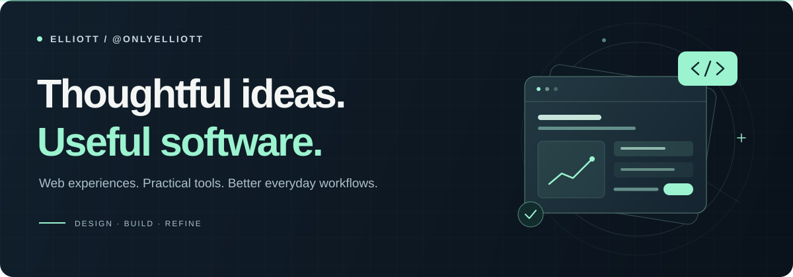

  

# Hi, I'm Elliott.

I build web experiences and practical tools, with a focus on clear interfaces and everyday usefulness.

[Explore my GitHub →](https://github.com/OnlyElliott?tab=repositories)

---

### What I build

| Web experiences | Everyday tools |
| :--- | :--- |
| Websites that bring a brand's ideas to life. | Applications that make business workflows easier to manage. |

### Tools in my projects

`React` · `JavaScript` · `Tailwind CSS` · `Vite` · `Base44`

### How I approach a build

Start with the problem. Make the interface clear. Refine the details.

---

Built with curiosity. Improved with every iteration.

